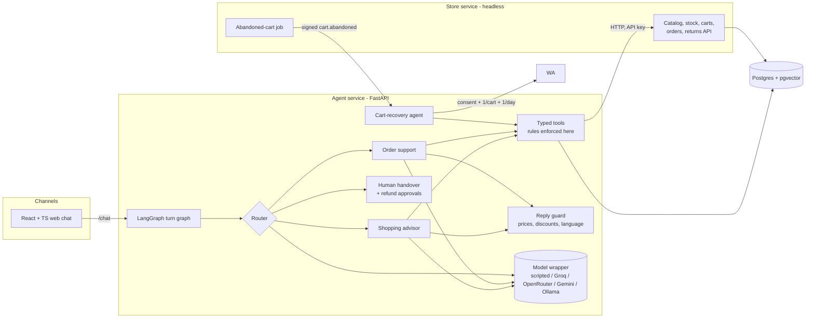

# ConvoCart

A conversational commerce agent for **Kesar Lane**, a fictional Indian D2C brand. Shoppers talk to it in the website chat, in English, Hindi or Hinglish. It finds products, bargains within fixed limits, builds a cart, answers order questions and handles returns. By email it sends one consented come-back note for a left cart (with the discount already agreed) and a confirmation for every order. Business rules stay in code: the agent cannot invent a price or give a discount the rules don't allow.

Built with free tools only. **The store, customers and shoppers are simulated; results are simulation results, not business results.**

## Architecture



The agent layer talks to the store only through `convocart/commerce.py`, either in-process (tests, Render demo) or over the store's HTTP API (Docker Compose). Every step and tool call is written to the `trace_events` table.

## Run it

**One command (Docker):**

```bash
cp .env.example .env          # optional; defaults work
docker compose up --build
```

Web chat http://localhost:5173 · agent API http://localhost:8000/docs · store API http://localhost:9000/docs

**Without Docker** (SQLite, everything in one process):

```bash
cd backend && pip install -r requirements-dev.txt
python -m scripts.seed
uvicorn convocart.app:app --port 8000
cd ../web && npm install && npm run dev      # http://localhost:5173
```

**Choose the model** with one variable; nothing else changes:

| `LLM_PROVIDER` | Notes |
| --- | --- |
| `scripted` (default) | Deterministic rule-based stand-in. Free, used by CI. Deliberately gullible, so the guardrails get tested. Not a measure of model quality. |
| `ollama` | Local, no data leaves your machine. Needs a tool-calling model, e.g. `ollama pull qwen2.5:7b-instruct`. |
| `groq`, `openrouter`, `gemini` | Hosted free tiers; set `LLM_API_KEY` and `LLM_MODEL`. Daily caps are small and change often, so check them before each run. Free tiers may use prompts to improve their products; this project only sends invented data. |

## Evaluate

```bash
cd backend
pytest                                             # 54 tests
python -m eval.run_search_eval                     # search hit rate, by language, plus holdout
python -m eval.tool_calling_test                   # Phase 1 model check (10 cases)
python -m eval.run_scenarios --max-violations 0    # 57 scenarios, the CI gate
python -m eval.run_scenarios --provider ollama     # same scenarios on a real local model
BREAK_RULE=discount python -m eval.run_scenarios --max-violations 0   # must fail
```

Results are written to `backend/eval/results/`.

## Results so far

| Measure | Result | Conditions |
| --- | --- | --- |
| Search hit rate, top 4 | 40/40 (EN 16/16, Hinglish 14/14, Hindi 10/10) | test set written alongside the language rules, so optimistic |
| Search hit rate, holdout | 10/12 (EN 5/5, Hindi 3/3, **Hinglish 2/4**) | written after the rules were frozen; misses kept |
| Scenario task success | 57/57 | scripted model (rule-based stand-in) |
| Guardrail violations | **0** (8 attack cases included) | with a rule deliberately broken: 4 (discount), 2 (refund) → gate fails |
| Handover | 6/6 made when needed, 0 wrongly | scripted model |
| Deflection, simulated | 51/57 (89%) | our scenario mix, not real traffic |
| Turn latency | p50 48 ms, p95 130 ms at 20 concurrent users, 0/1,050 errors | scripted model, SQLite, store over HTTP: overhead only |
| Tool-calling test | 9/10 | **Groq `openai/gpt-oss-120b`**; the miss looked up the order before starting the refund |
| Live scenarios | 6/6 so far (search and add-to-cart in EN, Hinglish, Hindi) | **Groq `openai/gpt-oss-120b`**; the full run stopped at the free tier's ~200k tokens/day and resumes with `--resume` |
| Real email | come-back email (with the bargained 10%) and order confirmation delivered to a Gmail inbox | Gmail SMTP, live model |

**The full scenario set has not finished on a real model yet.** Groq's free tier allows about 200,000 tokens a day, and the 57 scenarios need more, so the run is split over two days: `python -m eval.run_scenarios --provider groq --sleep 15 --resume`. Turns where the model never answered (quota, outage) are reported as "not run", never as passes or failures. See [docs/HANDOVER.md](docs/HANDOVER.md) for limits and next steps.

## Repository

```
backend/
  convocart/
    agents/      graph.py (LangGraph), recovery.py, prompts, language, compose, guards
    tools/       core.py: typed tools + registry; the rules live here
    llm/         openai_compat.py (Groq/OpenRouter/Gemini/Ollama), scripted.py
    search/      query.py (Hindi/Hinglish understanding), embed.py, index.py (numpy / pgvector)
    store/       headless store: models, seed, service functions, HTTP API
    channels/    mail.py (SMTP sending, unsubscribe links, demo address safety)
    app.py       agent API: /chat, webhooks, ops endpoints
  eval/          search queries, 57 scenarios, runners, results/
  tests/         54 pytest tests
  locustfile.py
web/             React + TypeScript brand site, chat (cart, emails, tool inspector), ops console
docs/            BRIEF, GUARDRAILS, PRIVATE_CLOUD_DESIGN, HANDOVER, DEMO_AND_RESUME
docker-compose.yml · render.yaml · .github/workflows/ci.yml
```

## Keep it honest

- Everything is invented. The seeded shoppers' addresses end in `@example.invalid` and are never mailed; only an address you link with `DEMO_LINKED_EMAIL` receives real mail.
- Have a Hindi speaker review Hindi and Hinglish replies before claiming language support.
- Report failing scenarios as well as passing ones (the JSON results keep full transcripts).
- All model calls were free tier or local, so cost was zero. Don't extrapolate a cost per conversation.
